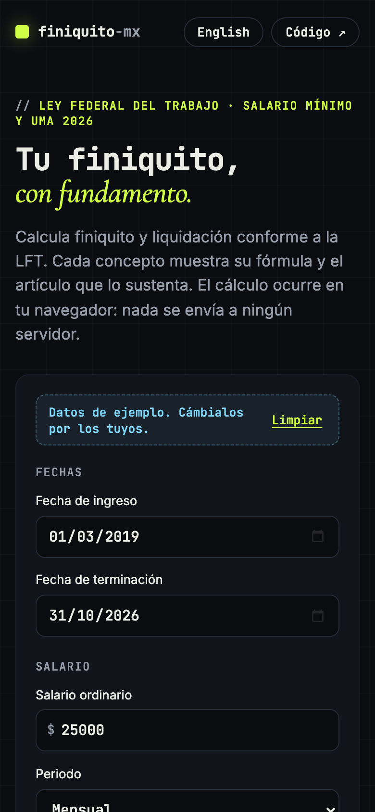
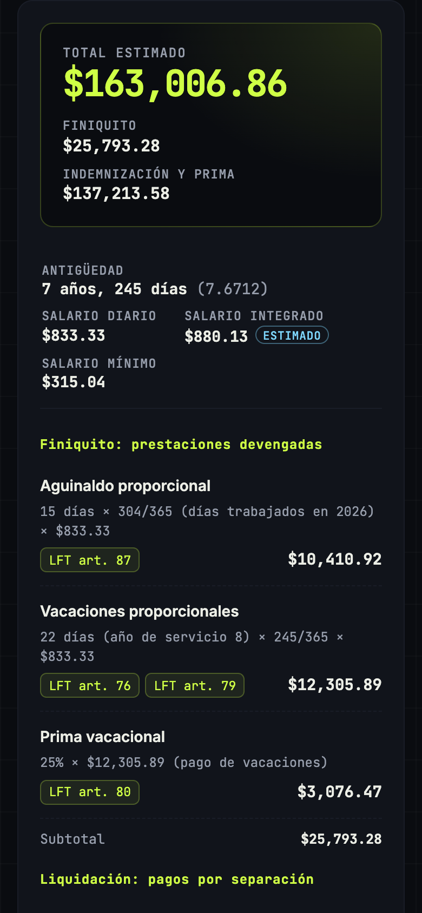
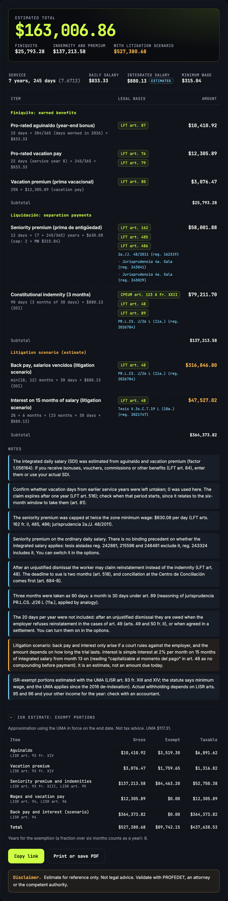
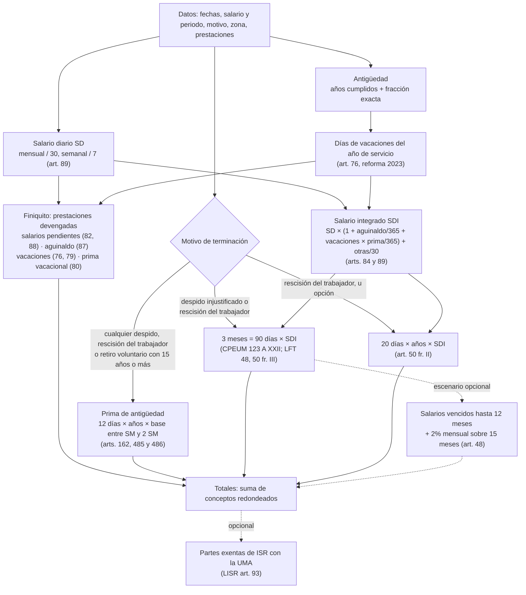

<p align="right"><a href="README.md">English</a> · <strong>Español</strong></p>

<p align="center">
  
</p>

<p align="center">
  <a href="https://github.com/BEG-lag/finiquito-mx/actions/workflows/ci.yml"></a>
  
  
  <a href="LICENSE"></a>
</p>

# finiquito-mx

**Calculadora rigurosa y probada de finiquito y liquidación conforme a la Ley Federal del Trabajo.**
Una biblioteca en TypeScript y una calculadora web estática. Cada concepto trae su fórmula y el artículo que lo fundamenta, y cada punto debatible es una opción explícita, no una decisión escondida.

- **Exacta al centavo.** Sin punto flotante: todas las cantidades son fracciones exactas sobre `BigInt` y se redondean una sola vez por concepto, con reglas documentadas.
- **Cita sus fuentes.** Cada concepto lleva su fundamento (LFT, CPEUM, LISR) y los criterios judiciales en que se apoya. El salario mínimo y la UMA llevan su fecha de publicación en el DOF.
- **Honesta con las zonas grises.** Donde los tribunales no coinciden, la calculadora lo dice y te deja elegir (salario base de la prima de antigüedad, mutuo acuerdo, los 20 días por año, escenario de juicio).
- **Privada por diseño.** La app corre completa en tu navegador, funciona sin conexión y los enlaces para compartir sólo llevan fechas y números.

**Pruébala:** https://beg-lag.github.io/finiquito-mx/

<p align="center">
  
</p>

<details>
<summary>Más capturas: teléfono, inglés, escenario de juicio y tabla de ISR</summary>

<p align="center">
  
  
</p>
<p align="center">
  
</p>
</details>

## Contenido

- [Inicio rápido](#inicio-rápido)
- [Ejemplo resuelto](#ejemplo-resuelto)
- [Cómo funciona](#cómo-funciona)
- [Reglas y fundamento](#reglas-y-fundamento)
- [Criterios debatibles, como opciones](#criterios-debatibles-como-opciones)
- [Redondeo](#redondeo)
- [Datos oficiales: salario mínimo y UMA](#datos-oficiales-salario-mínimo-y-uma)
- [Limitaciones](#limitaciones)
- [Desarrollo](#desarrollo)
- [Aviso](#aviso)
- [Autor](#autor)

## Inicio rápido

### Biblioteca

Todavía no está publicada en npm. Se instala desde GitHub (se compila al instalar):

```bash
npm install github:BEG-lag/finiquito-mx
```

```ts
import { calculateSeverance } from 'finiquito-mx';

const resultado = calculateSeverance({
  startDate: '2019-03-01',
  endDate: '2026-10-31',
  salary: { amount: '25000', period: 'monthly' },
  reason: 'unjustified-dismissal', // resignation | mutual-agreement | justified-dismissal | worker-rescission
  zone: 'general', // o 'zlfn' (Zona Libre de la Frontera Norte)
});

resultado.totals.total.formatted; // '$163,006.86'
resultado.items[3];
// {
//   id: 'seniority-premium',
//   label: 'Prima de antigüedad',
//   amount: { centavos: 5800188, amount: '58001.88', formatted: '$58,001.88' },
//   formula: '12 días × (7 + 245/365) años × $630.08 (tope: 2 × SM $315.04)',
//   legalBasis: ['LFT art. 162', 'LFT art. 485', 'LFT art. 486'],
//   criteria: ['2a./J. 48/2011 (reg. 162319)', 'Jurisprudencia 4a. Sala (reg. 243041)', ...],
//   ...
// }
resultado.notices; // explicaciones y advertencias, por ejemplo por qué no se incluyeron los 20 días por año
```

Todo está tipado: `SeveranceInput`, `SeveranceResult`, `LineItem`, `Notice`, `TaxEstimate`. Una captura inválida lanza `SeveranceInputError` con el `field` que falló. Las etiquetas, fórmulas y notas salen en español por omisión; con `{ locale: 'en' }` salen en inglés.

<details>
<summary>Todos los datos de entrada</summary>

| Campo | Significado | Por omisión |
|---|---|---|
| `startDate`, `endDate` | Primer y último día de trabajo, `AAAA-MM-DD` | obligatorio |
| `salary.amount`, `salary.period` | Salario ordinario y su periodo: `daily`, `weekly`, `biweekly`, `monthly` | obligatorio |
| `reason` | `resignation` (renuncia), `mutual-agreement` (mutuo acuerdo), `justified-dismissal` (despido justificado), `unjustified-dismissal` (despido injustificado), `worker-rescission` (rescisión por causa del patrón) | obligatorio |
| `zone` | `general` o `zlfn` | `general` |
| `benefits.aguinaldoDays` | Días de aguinaldo si son más de los 15 legales | 15 |
| `benefits.vacationPremiumPercent` | Prima vacacional si es mayor al 25% legal | 25 |
| `benefits.otherMonthly` | Otras prestaciones que integran el salario (art. 84), mensuales | 0 |
| `benefits.integratedDailySalary` | Tu SDI real; sustituye la estimación | estimado |
| `pending.wageDays` | Días trabajados y no pagados | 0 |
| `pending.vacationDaysFromPriorYears` | Vacaciones no disfrutadas de años cumplidos | 0 |
| `pending.vacationDaysTakenThisYear` | Vacaciones ya disfrutadas del año de servicio en curso | 0 |
| `options.seniorityPremiumBase` | `daily` (cuota diaria) o `integrated` (integrado) | `daily` |
| `options.mutualAgreementTreatedAs` | `voluntary` o `employer-initiated` | `voluntary` |
| `options.includeTwentyDaysPerYear` | Incluir el art. 50 fr. II | `true` sólo en `worker-rescission` |
| `options.litigationMonths` | Meses de juicio para el escenario de salarios vencidos | ninguno |
| `options.taxEstimate` | Estimar partes exentas de ISR | `true` |
| `indicators.minimumWageDaily`, `indicators.umaDaily` | Valores manuales para fechas fuera de las tablas o un salario mínimo profesional | tablas oficiales |

</details>

### Calculadora web

```bash
npm install
npm run dev        # http://localhost:5173
npm run build:web  # sitio estático en web-dist/, publicable en cualquier lado
```

El resultado es una carpeta estática sin servidor y sin peticiones a terceros: las fuentes van incluidas y un service worker guarda la app para usarla sin conexión. La URL se actualiza mientras capturas (`?i=2019-03-01&f=2026-10-31&s=25000&p=m&m=inj`), así que puedes compartir un cálculo sin enviar nombres ni datos personales. "Imprimir o guardar PDF" genera un desglose limpio en blanco y negro.

## Ejemplo resuelto

Despido injustificado de una persona que ingresó el 2019-03-01 y fue despedida el 2026-10-31, con salario de $25,000 mensuales en la zona general, más un escenario de 18 meses de juicio. El bloque siguiente lo genera [`scripts/readme-example.ts`](scripts/readme-example.ts) a partir de la biblioteca, y una prueba falla si este README se desfasa.

<!-- example:start (generated by scripts/readme-example.ts, do not edit) -->
Antigüedad: 7 años, 245 días (7.6712) · salario diario $833.33 · salario diario integrado (estimado) $880.13 · salario mínimo general 2026 $315.04

| Concepto | Fórmula | Fundamento | Importe |
|---|---|---|---:|
| Aguinaldo proporcional | `15 días × 304/365 (días trabajados en 2026) × $833.33` | LFT art. 87 | $10,410.92 |
| Vacaciones proporcionales | `22 días (año de servicio 8) × 245/365 × $833.33` | LFT art. 76, LFT art. 79 | $12,305.89 |
| Prima vacacional | `25% × $12,305.89 (pago de vacaciones)` | LFT art. 80 | $3,076.47 |
| Prima de antigüedad | `12 días × (7 + 245/365) años × $630.08 (tope: 2 × SM $315.04)` | LFT art. 162, LFT art. 485, LFT art. 486 | $58,001.88 |
| Indemnización constitucional (3 meses) | `90 días (3 meses de 30 días) × $880.13 (SDI)` | CPEUM art. 123 A fr. XXII, LFT art. 48, LFT art. 89 | $79,211.70 |
| **Total (finiquito + liquidación)** | | | **$163,006.86** |
| _Salarios vencidos (escenario de juicio)_ | `min(18, 12) meses × 30 días × $880.13 (SDI)` | LFT art. 48 | _$316,846.80_ |
| _Intereses sobre 15 meses de salario (escenario de juicio)_ | `2% × 6 meses × (15 meses × 30 días × $880.13)` | LFT art. 48 | _$47,527.02_ |
| _Con el escenario de 18 meses de juicio (estimación)_ | | | _$527,380.68_ |

Partes exentas de ISR (LISR art. 93, UMA 2026 de $117.31): aguinaldo $3,519.30 (tope 30 UMA), prima vacacional $1,759.65 (tope 15 UMA), pagos por separación $84,463.20 (tope 90 UMA × 8 años). Lo demás está gravado.
<!-- example:end -->

Fíjate en lo que **no** hace: no suma los 20 días por año (sólo proceden si el patrón se niega a reinstalar en los casos del art. 49, o si se pactan) y topa la prima de antigüedad en el doble del salario mínimo ($630.08 en lugar de $833.33). Son errores frecuentes en calculadoras en línea. El cálculo a mano de este caso, renglón por renglón, está en [`test/worked-examples.test.ts`](test/worked-examples.test.ts) junto con otros cinco casos.

## Cómo funciona



El núcleo es una función pura, [`calculateSeverance`](src/calculate.ts), sobre tres módulos pequeños: aritmética racional exacta ([`src/rational.ts`](src/rational.ts)), fechas civiles sin zonas horarias ([`src/dates.ts`](src/dates.ts)) y las tablas de datos oficiales ([`src/data/indicators.ts`](src/data/indicators.ts)).

## Reglas y fundamento

Texto de la Ley Federal del Trabajo cotejado con la versión vigente de la Cámara de Diputados, última reforma publicada en el DOF el 14-05-2026.

| Concepto | Regla implementada | Fundamento |
|---|---|---|
| Salario diario | Mensual / 30, semanal / 7; quincenal / 15 (por analogía con el mes de 30 días) | LFT art. 89 |
| Salario diario integrado (SDI) | SD × (1 + días de aguinaldo / 365 + días de vacaciones × % de prima / 365) + otras prestaciones mensuales / 30. Puedes capturar tu SDI real | LFT arts. 84 y 89 |
| Salarios pendientes | Días no pagados × SD | LFT arts. 82 y 88 |
| Aguinaldo | Días anuales (mínimo 15) × días trabajados en el año calendario / 365 (366 en bisiestos) × SD | LFT art. 87 |
| Vacaciones | Días del año de servicio en curso × fracción transcurrida − días ya disfrutados, × SD. Si la terminación cierra un año completo, se paga el periodo completo de ese año. Los días no disfrutados de años anteriores se capturan | LFT arts. 76, 79 y 81 |
| Prima vacacional | Al menos 25% del pago de vacaciones | LFT art. 80 |
| Prima de antigüedad | 12 días × años de servicio (fracción proporcional) × salario base, con piso de un salario mínimo y tope de dos de la zona. Procede en todo despido (justificado o no), en la rescisión por el trabajador y, en el retiro voluntario, sólo con 15 años o más | LFT arts. 162, 485 y 486; 2a./J. 48/2011 (reg. 162319); jurisprudencias reg. 243041 (pago proporcional) y reg. 243029 (sin requisito de 15 años en el despido) |
| Indemnización constitucional | 3 meses = 90 días × SDI, en despido injustificado (si se elige indemnización en vez de reinstalación) o rescisión por el trabajador | CPEUM art. 123 A fr. XXII; LFT arts. 48, 50 fr. III, 52 y 89; PR.L.CS. J/26 L (11a.) por analogía |
| 20 días por año | 20 días × años (fracción proporcional) × SDI. Obligatoria en la rescisión por el trabajador; en el despido injustificado sólo si el patrón se niega a reinstalar (art. 49) o si se pacta | LFT arts. 49, 50 fr. II y 52; PR.L.CS. J/37 L (11a.) (reg. 2027249) |
| Salarios vencidos | Escenario: min(meses, 12) × 30 × SDI | LFT art. 48, párrafo segundo; PR.L.CS. J/26 L (11a.) (reg. 2026784) |
| Intereses | Escenario: 2% × (meses − 12) × 15 meses × 30 × SDI, interés simple | LFT art. 48, párrafo tercero; tesis V.3o.C.T.19 L (10a.) (reg. 2021747) |
| Partes exentas de ISR | Aguinaldo hasta 30 UMA; prima vacacional hasta 15 UMA; prima de antigüedad e indemnizaciones hasta 90 UMA por año de servicio (fracción de más de seis meses cuenta como año). Salarios, vacaciones y salarios vencidos están gravados | LISR art. 93 fr. XIII y XIV; decreto de desindexación (DOF 27-01-2016) |

Tabla de vacaciones de la reforma de 2022 (vigente desde el 1 de enero de 2023), en [`src/rules.ts`](src/rules.ts):

| Año de servicio | 1 | 2 | 3 | 4 | 5 | 6-10 | 11-15 | 16-20 | 21-25 | 26-30 | 31-35 |
|---|---|---|---|---|---|---|---|---|---|---|---|
| Días | 12 | 14 | 16 | 18 | 20 | 22 | 24 | 26 | 28 | 30 | 32 |

## Criterios debatibles, como opciones

| Punto | Por omisión | Alternativa | Por qué es debatible |
|---|---|---|---|
| Salario base de la prima de antigüedad | Cuota diaria (`daily`) | `integrated` | No hay jurisprudencia. Las tesis aisladas reg. 242881, 215596 y 248481 excluyen el salario integrado; la reg. 243324 lo incluye. Con salarios mayores a dos mínimos, el tope vuelve irrelevante la elección. |
| Mutuo acuerdo (art. 53 fr. I) | Se trata como retiro voluntario: la prima requiere 15 años (tesis aislada reg. 243325) | `employer-initiated`: la prima procede sin importar la antigüedad (jurisprudencia reg. 243029) | Depende de quién decidió en los hechos la separación. |
| 20 días por año en el despido injustificado | No se incluyen | `includeTwentyDaysPerYear: true` | Sólo proceden si el patrón se niega a reinstalar en los casos del art. 49, o si se negocian. En la rescisión por el trabajador se incluyen solos (art. 52). |
| Meses de juicio | Sin escenario | `litigationMonths` | Los salarios vencidos dependen de una condena y de cuánto dure el juicio. Se muestran aparte y marcados como estimación. |
| Intereses "capitalizable al momento del pago" | Interés simple | ninguna | Se lee como que no hay capitalización antes del pago. |
| Tres meses | 90 días | captura un SDI o salario conocido | El mes es de 30 días según el art. 89 (PR.L.CS. J/26 L (11a.), por analogía). La tesis I.13o.T.265 L cuenta los días efectivamente laborados en jornadas reducidas. |
| Vacaciones cuando la terminación cierra un año completo | Se paga el periodo completo de ese año | ninguna | Ya se generó y no pudo disfrutarse. |
| Jurisprudencia regional | Se aplica | ninguna | Los criterios PR.L.CS. obligan en la Región Centro-Sur (Pleno Regional); fuera de ella orientan. |
| Salario mínimo o UMA para el tope de la prima | Salario mínimo | ninguna | Los arts. 485 y 486 hablan de salario mínimo; la tesis III.2o.T.62 L (11a.) (reg. 2028637) confirma que no es la UMA. |

Los criterios judiciales se citan por su registro digital en el Semanario Judicial de la Federación. Verifica su vigencia antes de citarlos en un escrito.

## Redondeo

1. El salario diario (salario / días del periodo) y el salario diario integrado se redondean a centavos, como los expresan la nómina y los tribunales.
2. Los días y proporciones (304/365, 7 + 245/365 años) se mantienen como fracciones exactas.
3. Cada concepto se calcula exacto y se redondea **una vez**, al centavo, con medio hacia arriba (alejándose de cero).
4. La prima vacacional es un porcentaje del pago de vacaciones ya redondeado, así que la fórmula se reproduce con los números que muestra.
5. Los totales son sumas de conceptos redondeados: la tabla siempre cuadra.

## Datos oficiales: salario mínimo y UMA

Valores cotejados con sus publicaciones oficiales el 17-11-2026. Viven en [`src/data/indicators.ts`](src/data/indicators.ts) con su fuente; para fechas fuera de estas tablas hay que capturar el valor, nunca se adivina.

| Indicador | Valor diario | Vigencia | Publicación | Fuente |
|---|---|---|---|---|
| Salario mínimo 2026, zona general | $315.04 | 01-01-2026 a 31-12-2026 | DOF 09-12-2025 | [Resolución CONASAMI](https://dof.gob.mx/nota_detalle.php?codigo=5775534&fecha=09/12/2025) |
| Salario mínimo 2026, Zona Libre de la Frontera Norte | $440.87 | 01-01-2026 a 31-12-2026 | DOF 09-12-2025 | la misma |
| Salario mínimo 2025, zona general | $278.80 | 01-01-2025 a 31-12-2025 | DOF 19-12-2024 | [Resolución CONASAMI](https://dof.gob.mx/nota_detalle.php?codigo=5745678&fecha=19/12/2024) |
| Salario mínimo 2025, ZLFN | $419.88 | 01-01-2025 a 31-12-2025 | DOF 19-12-2024 | la misma |
| UMA 2026 | $117.31 (mensual $3,566.22; anual $42,794.64) | 01-02-2026 a 31-01-2027 | DOF 09-01-2026 | [Aviso del INEGI](https://dof.gob.mx/nota_detalle.php?codigo=5778072&fecha=09/01/2026), [comunicado 1/26](https://www.inegi.org.mx/contenidos/saladeprensa/boletines/2026/uma/uma2026.pdf) |
| UMA 2025 | $113.14 | 01-02-2025 a 31-01-2026 | DOF 10-01-2025 | [Aviso del INEGI](https://dof.gob.mx/nota_detalle.php?codigo=5746930&fecha=10/01/2025) |
| UMA 2024 | $108.57 | 01-02-2024 a 31-01-2025 | DOF 10-01-2024 | [Copia del INEGI del aviso en el DOF](https://sc.inegi.org.mx/repositorioNormateca/UMA24.pdf) |
| Ley Federal del Trabajo | texto vigente | última reforma DOF 14-05-2026 | | [Cámara de Diputados](https://www.diputados.gob.mx/LeyesBiblio/pdf/LFT.pdf) |

La UMA cambia cada 1 de febrero, así que una terminación en enero usa la UMA del año anterior. La CONASAMI publicará el salario mínimo 2027 en diciembre de 2026; mientras no se agregue, las terminaciones de 2027 con prima de antigüedad requieren `indicators.minimumWageDaily`.

## Limitaciones

- **Sólo relaciones por tiempo indeterminado.** No modela contratos por tiempo u obra determinados (art. 50 fr. I), plataformas digitales (art. 50 fr. IV), trabajo del hogar ni otros regímenes especiales.
- **El salario variable** lo promedias tú (art. 89, párrafo segundo: últimos 30 días efectivamente trabajados) y lo capturas como salario u otras prestaciones.
- **El SDI es una estimación** salvo que captures el tuyo. El SDI real puede incluir conceptos que esta herramienta no ve.
- **ISR:** sólo se estiman las partes exentas. La retención real depende de los arts. 95 y 96 de la LISR y del resto de tus ingresos del año. No es asesoría fiscal.
- **No incluye:** PTU (que el convenio debe desglosar, art. 987), aguinaldo ya pagado en el año, fondo de ahorro, IMSS/INFONAVIT, muerte del trabajador (art. 162 fr. V) ni la regla del 10% para diferir la prima en retiros voluntarios masivos (art. 162 fr. IV).
- **La prescripción** de vacaciones no disfrutadas y demás acciones (arts. 516 a 518) no se valida.
- **Salario durante el juicio:** los tres meses y los salarios vencidos usan el salario a la fecha de terminación. El art. 48 habla del salario a la fecha en que se realice el pago, así que no se modelan aumentos durante un juicio largo.
- **Salarios mínimos profesionales** (2a./J. 49/2013): se capturan como valor manual; la tabla sólo trae el general y el de la ZLFN.

## Desarrollo

```bash
npm install
npm run check        # tipos + lint + revisión de guiones largos + pruebas con cobertura + build
npm run test:watch
npm run example      # imprime el ejemplo del README desde el código
npm run readme:sync  # reescribe los bloques del ejemplo en ambos README
npm run build:web && npm run screenshots   # revisiones en navegador sin interfaz + capturas
```

- **Pruebas** ([`test/`](test)): seis ejemplos resueltos a mano con la aritmética en comentarios, casos límite (ingreso y baja el mismo día, años bisiestos e ingresos un 29 de febrero, exactamente 15 años, piso y tope del salario mínimo, cada opción, ambos idiomas), pruebas basadas en propiedades con [fast-check](https://fast-check.dev) (los totales cuadran, nada es negativo, más salario o más antigüedad nunca reduce el resultado, lo exento nunca supera lo bruto) y pruebas del estado de la URL. CI exige umbrales de cobertura.
- **Revisiones en navegador** ([`scripts/screenshots.ts`](scripts/screenshots.ts)): sin errores en consola, sin desplazamiento horizontal a 390 px, todos los controles con etiqueta, navegación con teclado de los motivos y vista de impresión sin el formulario.
- **CI** ([`.github/workflows/ci.yml`](.github/workflows/ci.yml)): tipos, lint, pruebas con cobertura y build en Node 22 y 24. [`pages.yml`](.github/workflows/pages.yml) publica la calculadora en GitHub Pages.

## Aviso

**Estimación sólo de referencia. No es asesoría legal. Valida con la PROFEDET, con un abogado o con la autoridad competente.**

Este software no constituye opinión legal ni asesoría fiscal. Un conflicto laboral depende de hechos, pruebas y criterios que una calculadora no puede ver. La PROFEDET (Procuraduría Federal de la Defensa del Trabajo) asesora gratis a las personas trabajadoras.

## Autor

**Benjamín Esponda García**, abogado corporativo mexicano (unos ocho años de práctica) en la Ciudad de México, que construye herramientas legales con IA.

- Sitio: [pivotek.mx](https://pivotek.mx)
- Portafolio de IA: [github.com/BEG-lag/portafolio-ia](https://github.com/BEG-lag/portafolio-ia)
- Para abogados: [Con Criterio](https://concriterio.mx), kit de IA para la práctica legal en México (guía, plugins y skills de Claude Code).

Desarrollado con asistencia de IA (Claude Code). Se agradecen issues y correcciones, sobre todo de interpretación legal.

Publicado bajo la [licencia MIT](LICENSE).
