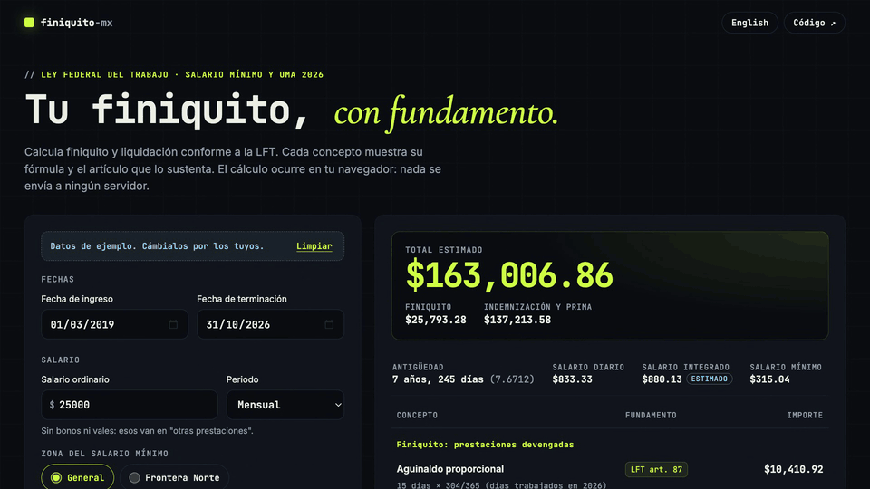
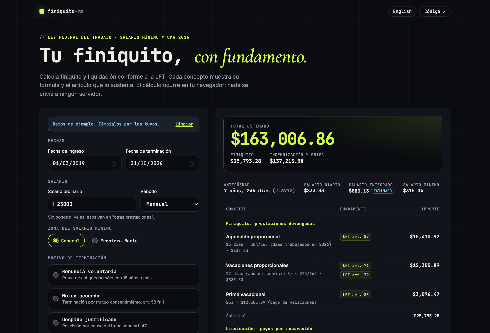
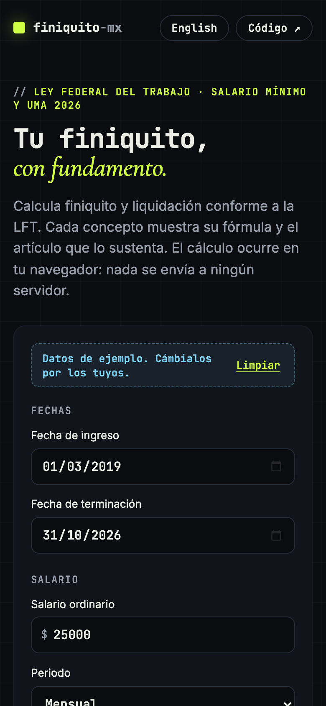
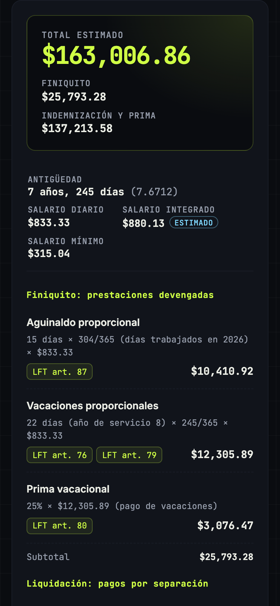
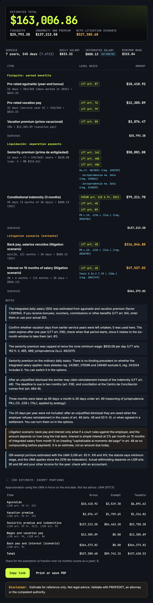
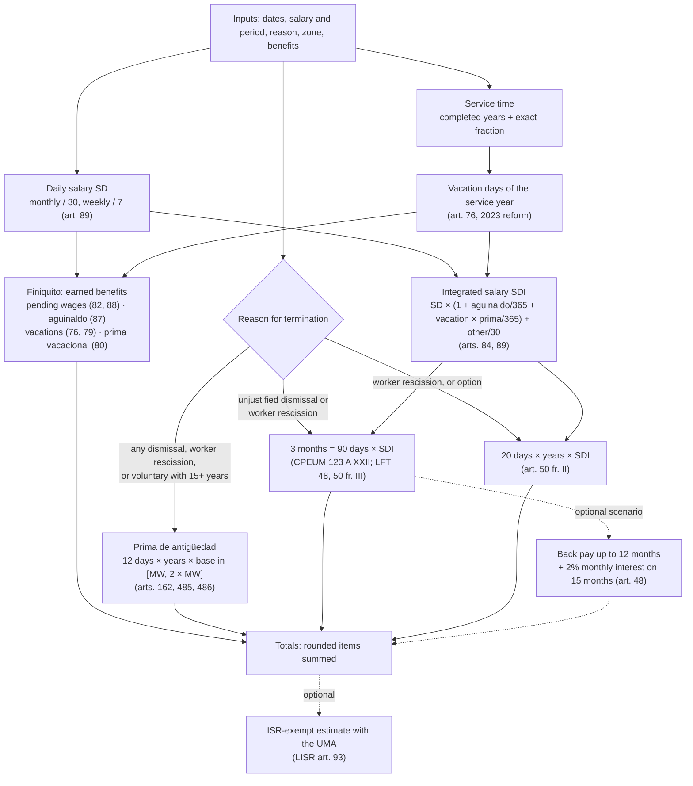

<p align="center">
  <a href="https://pivotek.mx"></a>
</p>

<p align="right"><strong>English</strong> · <a href="README.es.md">Español</a></p>

<p align="center">
  
</p>

<p align="center">
  <a href="https://github.com/BEG-lag/finiquito-mx/actions/workflows/ci.yml"></a>
  
  
  <a href="LICENSE"></a>
</p>

<!-- demo:start -->
<p align="center">
  
</p>
<p align="center"><sub>Real recording of <a href="https://beg-lag.github.io/finiquito-mx/">the live app</a>. <a href="assets/demo.mp4">MP4 version</a>.</sub></p>
<!-- demo:end -->

# finiquito-mx

**A rigorous, tested calculator of _finiquito_ and _liquidación_ (severance) under Mexico's Ley Federal del Trabajo.**
A TypeScript library plus a static web calculator. Every line item comes with its formula and the article of law that supports it, and every debatable point is an explicit option instead of a silent choice.

- **Exact to the centavo.** No floating point: all quantities are exact fractions on `BigInt`, rounded once per line item under documented rules.
- **Cites its sources.** Each item carries its statutory basis (LFT, CPEUM, LISR) and the judicial criteria it relies on. Minimum wage and UMA values carry their DOF publication date.
- **Honest about the gray areas.** Where courts disagree, the calculator says so and lets you pick (base salary of the _prima de antigüedad_, mutual agreement, the 20 days per year, a litigation scenario).
- **Private by design.** The web app runs entirely in the browser, works offline, and shareable links carry only dates and numbers.

**Try it:** https://beg-lag.github.io/finiquito-mx/ (the Spanish interface has an English toggle).

<p align="center">
  
</p>

<details>
<summary>More screenshots: phone, English, litigation scenario and ISR table</summary>

<p align="center">
  
  
</p>
<p align="center">
  
</p>
</details>

## Contents

- [Quickstart](#quickstart)
- [Worked example](#worked-example)
- [How it works](#how-it-works)
- [Rules and legal basis](#rules-and-legal-basis)
- [Debatable points, exposed as options](#debatable-points-exposed-as-options)
- [Rounding](#rounding)
- [Official data: minimum wage and UMA](#official-data-minimum-wage-and-uma)
- [Limitations](#limitations)
- [Development](#development)
- [Disclaimer](#disclaimer)
- [Author](#author)

## Quickstart

### Library

Not published to npm yet. Install it from GitHub (it builds on install):

```bash
npm install github:BEG-lag/finiquito-mx
```

```ts
import { calculateSeverance } from 'finiquito-mx';

const result = calculateSeverance(
  {
    startDate: '2019-03-01',
    endDate: '2026-10-31',
    salary: { amount: '25000', period: 'monthly' },
    reason: 'unjustified-dismissal', // resignation | mutual-agreement | justified-dismissal | worker-rescission
    zone: 'general', // or 'zlfn' (Zona Libre de la Frontera Norte)
  },
  { locale: 'en' }, // labels, formulas and notes in English ('es' by default)
);

result.totals.total.formatted; // '$163,006.86'
result.items[3];
// {
//   id: 'seniority-premium',
//   label: 'Seniority premium (prima de antigüedad)',
//   amount: { centavos: 5800188, amount: '58001.88', formatted: '$58,001.88' },
//   formula: '12 days × (7 + 245/365) years × $630.08 (cap: 2 × MW $315.04)',
//   legalBasis: ['LFT art. 162', 'LFT art. 485', 'LFT art. 486'],
//   criteria: ['2a./J. 48/2011 (reg. 162319)', 'Jurisprudencia 4a. Sala (reg. 243041)', ...],
//   ...
// }
result.notices; // explanations and warnings, e.g. that the 20 days per year were not included and why
```

Everything is typed: `SeveranceInput`, `SeveranceResult`, `LineItem`, `Notice`, `TaxEstimate`. Invalid input throws a `SeveranceInputError` with the offending `field`.

<details>
<summary>All inputs</summary>

| Field | Meaning | Default |
|---|---|---|
| `startDate`, `endDate` | First and last day of work, `YYYY-MM-DD` | required |
| `salary.amount`, `salary.period` | Ordinary salary and its period: `daily`, `weekly`, `biweekly`, `monthly` | required |
| `reason` | `resignation`, `mutual-agreement`, `justified-dismissal`, `unjustified-dismissal`, `worker-rescission` | required |
| `zone` | `general` or `zlfn` | `general` |
| `benefits.aguinaldoDays` | Aguinaldo days if above the legal 15 | 15 |
| `benefits.vacationPremiumPercent` | Prima vacacional if above the legal 25% | 25 |
| `benefits.otherMonthly` | Other benefits that integrate salary (art. 84), monthly | 0 |
| `benefits.integratedDailySalary` | Your actual SDI; replaces the estimate | estimated |
| `pending.wageDays` | Days worked and not paid | 0 |
| `pending.vacationDaysFromPriorYears` | Untaken vacation days from completed years | 0 |
| `pending.vacationDaysTakenThisYear` | Vacation days already taken in the service year in progress | 0 |
| `options.seniorityPremiumBase` | `daily` or `integrated` | `daily` |
| `options.mutualAgreementTreatedAs` | `voluntary` or `employer-initiated` | `voluntary` |
| `options.includeTwentyDaysPerYear` | Include art. 50 fr. II | `true` only for `worker-rescission` |
| `options.litigationMonths` | Months of trial for the back-pay scenario | none |
| `options.taxEstimate` | Estimate ISR-exempt portions | `true` |
| `indicators.minimumWageDaily`, `indicators.umaDaily` | Overrides for dates outside the bundled tables or a professional minimum wage | official tables |

</details>

### Web calculator

```bash
npm install
npm run dev        # http://localhost:5173
npm run build:web  # static site in web-dist/, deployable anywhere
```

The build is a static folder with no server and no third-party requests: fonts are self-hosted and a service worker precaches the app for offline use. The URL updates as you type (`?i=2019-03-01&f=2026-10-31&s=25000&p=m&m=inj`), so a calculation can be shared without sending names or any personal data. "Print or save PDF" produces a clean black-on-white breakdown.

## Worked example

Unjustified dismissal of a worker hired on 2019-03-01 and dismissed on 2026-10-31, earning $25,000 a month in the general zone, plus an 18-month litigation scenario. The block below is generated by [`scripts/readme-example.ts`](scripts/readme-example.ts) from the library itself, and a test fails if the README drifts from it.

<!-- example:start (generated by scripts/readme-example.ts, do not edit) -->
Service: 7 years, 245 days (7.6712) · daily salary $833.33 · integrated daily salary (estimated) $880.13 · 2026 general minimum wage $315.04

| Item | Formula | Legal basis | Amount |
|---|---|---|---:|
| Pro-rated aguinaldo (year-end bonus) | `15 days × 304/365 (days worked in 2026) × $833.33` | LFT art. 87 | $10,410.92 |
| Pro-rated vacation pay | `22 days (service year 8) × 245/365 × $833.33` | LFT art. 76, LFT art. 79 | $12,305.89 |
| Vacation premium (prima vacacional) | `25% × $12,305.89 (vacation pay)` | LFT art. 80 | $3,076.47 |
| Seniority premium (prima de antigüedad) | `12 days × (7 + 245/365) years × $630.08 (cap: 2 × MW $315.04)` | LFT art. 162, LFT art. 485, LFT art. 486 | $58,001.88 |
| Constitutional indemnity (3 months) | `90 days (3 months of 30 days) × $880.13 (SDI)` | CPEUM art. 123 A fr. XXII, LFT art. 48, LFT art. 89 | $79,211.70 |
| **Total (finiquito + liquidación)** | | | **$163,006.86** |
| _Back pay, salarios vencidos (litigation scenario)_ | `min(18, 12) months × 30 days × $880.13 (SDI)` | LFT art. 48 | _$316,846.80_ |
| _Interest on 15 months of salary (litigation scenario)_ | `2% × 6 months × (15 months × 30 days × $880.13)` | LFT art. 48 | _$47,527.02_ |
| _With the 18-month litigation scenario (estimate)_ | | | _$527,380.68_ |

ISR-exempt portions (LISR art. 93, UMA 2026 of $117.31): aguinaldo $3,519.30 (cap 30 UMA), prima vacacional $1,759.65 (cap 15 UMA), separation pay $84,463.20 (cap 90 UMA × 8 years). Everything else is taxable.
<!-- example:end -->

Notice what it does **not** do: it does not add the 20 days per year (they are owed only if the employer refuses reinstatement under art. 49, or if agreed), and it caps the _prima de antigüedad_ at twice the minimum wage ($630.08 instead of $833.33). Both are common mistakes in online calculators. The hand computation of this case, line by line, is in [`test/worked-examples.test.ts`](test/worked-examples.test.ts) together with five more cases.

## How it works



The core is a single pure function, [`calculateSeverance`](src/calculate.ts), built on three small modules: exact rational arithmetic ([`src/rational.ts`](src/rational.ts)), civil-date arithmetic without time zones ([`src/dates.ts`](src/dates.ts)), and the official data tables ([`src/data/indicators.ts`](src/data/indicators.ts)).

## Rules and legal basis

Text of the Ley Federal del Trabajo checked against the official version of the Cámara de Diputados, last reform published in the DOF on 2026-05-14.

| Item | Rule implemented | Legal basis |
|---|---|---|
| Daily salary | Monthly / 30, weekly / 7; biweekly / 15 (by analogy with the 30-day month) | LFT art. 89 |
| Integrated daily salary (SDI) | SD × (1 + aguinaldo days / 365 + vacation days × prima % / 365) + other monthly benefits / 30. Your actual SDI can be entered instead | LFT arts. 84, 89 |
| Pending wages | Unpaid days × SD | LFT arts. 82, 88 |
| Aguinaldo | Annual days (min. 15) × days worked in the calendar year / 365 (366 in leap years) × SD | LFT art. 87 |
| Vacations | Days of the service year in progress × elapsed fraction − days already taken, × SD. If the end date closes a full year, that year's full entitlement is owed. Untaken days from earlier years are an input | LFT arts. 76, 79, 81 |
| Prima vacacional | At least 25% of the vacation pay | LFT art. 80 |
| Prima de antigüedad | 12 days × years of service (fraction pro-rated) × daily base, floored at one and capped at two minimum wages of the zone. Owed on any dismissal (justified or not), on rescission by the worker, and on voluntary separation only after 15 years | LFT arts. 162, 485, 486; 2a./J. 48/2011 (reg. 162319); jurisprudencia reg. 243041 (pro-rating) and reg. 243029 (no 15-year requirement on dismissal) |
| Constitutional indemnity | 3 months = 90 days × SDI, on unjustified dismissal (worker chooses indemnity over reinstatement) or rescission by the worker | CPEUM art. 123 A fr. XXII; LFT arts. 48, 50 fr. III, 52, 89; PR.L.CS. J/26 L (11a.) by analogy |
| 20 days per year | 20 days × years (fraction pro-rated) × SDI. Mandatory on rescission by the worker; on unjustified dismissal only if the employer refuses reinstatement (art. 49) or if agreed | LFT arts. 49, 50 fr. II, 52; PR.L.CS. J/37 L (11a.) (reg. 2027249) |
| Back pay (_salarios vencidos_) | Scenario: min(months, 12) × 30 × SDI | LFT art. 48, 2nd paragraph; PR.L.CS. J/26 L (11a.) (reg. 2026784) |
| Interest | Scenario: 2% × (months − 12) × 15 months × 30 × SDI, simple interest | LFT art. 48, 3rd paragraph; tesis V.3o.C.T.19 L (10a.) (reg. 2021747) |
| ISR-exempt portions | Aguinaldo up to 30 UMA; prima vacacional up to 15 UMA; prima de antigüedad and indemnities up to 90 UMA per year of service (a fraction over six months counts as a year). Wages, vacation pay and back pay are taxable | LISR art. 93 fr. XIII, XIV; de-indexation decree (DOF 2016-01-27) |

Vacation schedule after the 2022 reform (in force since 2023-01-01), implemented in [`src/rules.ts`](src/rules.ts):

| Service year | 1 | 2 | 3 | 4 | 5 | 6-10 | 11-15 | 16-20 | 21-25 | 26-30 | 31-35 |
|---|---|---|---|---|---|---|---|---|---|---|---|
| Days | 12 | 14 | 16 | 18 | 20 | 22 | 24 | 26 | 28 | 30 | 32 |

## Debatable points, exposed as options

| Point | Default | Alternative | Why it is debatable |
|---|---|---|---|
| Base salary of the _prima de antigüedad_ | Ordinary daily salary (`daily`) | `integrated` | No binding precedent. Tesis aisladas reg. 242881, 215596 and 248481 exclude the integrated salary; reg. 243324 includes it. With salaries above two minimum wages the cap makes the choice irrelevant. |
| Mutual agreement (art. 53 fr. I) | Treated as voluntary separation: the prima needs 15 years (tesis aislada reg. 243325) | `employer-initiated`: the prima is owed regardless of tenure (jurisprudencia reg. 243029) | Depends on who actually decided the separation. |
| 20 days per year on unjustified dismissal | Not included | `includeTwentyDaysPerYear: true` | Owed only when the employer refuses reinstatement in the cases of art. 49, or when negotiated. Included automatically for rescission by the worker (art. 52). |
| Months of litigation | No scenario | `litigationMonths` | Back pay depends on a court ruling and on how long the trial lasts. Shown separately and labeled as an estimate. |
| Interest "capitalizable al momento del pago" | Simple interest | none | The statute is read as no compounding before payment. |
| Three months | 90 days | enter a known SDI or salary | A month is 30 days under art. 89 (PR.L.CS. J/26 L (11a.), applied by analogy). Tesis I.13o.T.265 L counts the days actually worked for reduced workweeks. |
| Vacations when the end date closes a full year | The full entitlement of that year is owed | none | It was earned and could not have been taken yet. |
| Regional jurisprudence | Applied | none | PR.L.CS. criteria bind the Centro-Sur region (Pleno Regional); elsewhere they are persuasive. |
| Minimum wage vs UMA for the cap of the prima | Minimum wage | none | LFT arts. 485 and 486 refer to the minimum wage; tesis III.2o.T.62 L (11a.) (reg. 2028637) confirms it is not the UMA. |

Judicial criteria are cited by their registry number (_registro digital_) in the Semanario Judicial de la Federación. Verify that they remain in force before citing them in a filing.

## Rounding

1. The daily salary (salary / period days) and the integrated daily salary are rounded to centavos, as payroll and courts state them.
2. Day counts and proportions (304/365, 7 + 245/365 years) stay exact fractions.
3. Each line item is computed exactly and rounded **once**, half away from zero, to centavos.
4. The prima vacacional is a percentage of the already-rounded vacation pay, so the formula can be reproduced from the numbers shown.
5. Totals are sums of rounded line items, so the table always adds up.

## Official data: minimum wage and UMA

Values checked against their official publications on 2026-11-17. They live in [`src/data/indicators.ts`](src/data/indicators.ts) with their sources; dates outside these tables require an explicit override, never a guess.

| Indicator | Value (daily) | In force | Published | Source |
|---|---|---|---|---|
| Minimum wage 2026, general zone | $315.04 | 2026-01-01 to 2026-12-31 | DOF 2025-12-09 | [CONASAMI resolution](https://dof.gob.mx/nota_detalle.php?codigo=5775534&fecha=09/12/2025) |
| Minimum wage 2026, Zona Libre de la Frontera Norte | $440.87 | 2026-01-01 to 2026-12-31 | DOF 2025-12-09 | same |
| Minimum wage 2025, general zone | $278.80 | 2025-01-01 to 2025-12-31 | DOF 2024-12-19 | [CONASAMI resolution](https://dof.gob.mx/nota_detalle.php?codigo=5745678&fecha=19/12/2024) |
| Minimum wage 2025, ZLFN | $419.88 | 2025-01-01 to 2025-12-31 | DOF 2024-12-19 | same |
| UMA 2026 | $117.31 (monthly $3,566.22; annual $42,794.64) | 2026-02-01 to 2027-01-31 | DOF 2026-01-09 | [INEGI notice](https://dof.gob.mx/nota_detalle.php?codigo=5778072&fecha=09/01/2026), [press release 1/26](https://www.inegi.org.mx/contenidos/saladeprensa/boletines/2026/uma/uma2026.pdf) |
| UMA 2025 | $113.14 | 2025-02-01 to 2026-01-31 | DOF 2025-01-10 | [INEGI notice](https://dof.gob.mx/nota_detalle.php?codigo=5746930&fecha=10/01/2025) |
| UMA 2024 | $108.57 | 2024-02-01 to 2025-01-31 | DOF 2024-01-10 | [INEGI copy of the DOF notice](https://sc.inegi.org.mx/repositorioNormateca/UMA24.pdf) |
| Ley Federal del Trabajo | text in force | last reform DOF 2026-05-14 | | [Cámara de Diputados](https://www.diputados.gob.mx/LeyesBiblio/pdf/LFT.pdf) |

The UMA changes every February 1, so a termination in January uses the previous year's UMA. The 2027 minimum wage will be published by CONASAMI in December 2026; until it is added, terminations in 2027 that owe a _prima de antigüedad_ require `indicators.minimumWageDaily`.

## Limitations

- **Indefinite-term employment only.** Fixed-term or project contracts (art. 50 fr. I), platform workers (art. 50 fr. IV), domestic work and other special regimes are not modeled.
- **Variable pay** must be averaged by you (art. 89, 2nd paragraph: last 30 days actually worked) and entered as the salary or as other benefits.
- **The SDI is an estimate** unless you enter yours. Real SDIs may include items this tool cannot see.
- **ISR:** only the exempt portions are estimated. The actual withholding depends on LISR arts. 95 and 96 and on the rest of the year's income. Not tax advice.
- **Not included:** PTU (profit sharing, which a settlement must itemize under art. 987), aguinaldo already paid during the year, savings funds, IMSS/INFONAVIT, death of the worker (art. 162 fr. V), and the 10% rule for deferring the prima on mass voluntary retirements (art. 162 fr. IV).
- **Prescription** of untaken vacations and other claims (arts. 516 to 518) is not validated.
- **Salary during a trial:** the three months and the back pay use the salary on the end date. Art. 48 refers to the salary at the date of payment, so raises during a long trial are not modeled.
- **Professional minimum wages** (2a./J. 49/2013) can be passed as an override; the table bundles only the general and ZLFN minimum wages.

## Development

```bash
npm install
npm run check        # typecheck + lint + em-dash check + tests with coverage + build
npm run test:watch
npm run example      # print the README worked example from the code
npm run readme:sync  # rewrite the example blocks in both READMEs
npm run build:web && npm run screenshots   # headless-browser smoke checks + screenshots
```

- **Tests** ([`test/`](test)): 123 tests in 9 files, with 100% line coverage. They include six hand-checked worked examples with the arithmetic in comments, edge cases (same-day employment, leap years and February 29 hires, exactly 15 years, the minimum-wage floor and cap, every option, both languages), property-based tests with [fast-check](https://fast-check.dev) (totals add up, nothing is negative, more salary or more tenure never lowers the result, exempt never exceeds gross), and tests of the shareable-URL state. Coverage thresholds are enforced in CI.
- **Browser checks** ([`scripts/screenshots.ts`](scripts/screenshots.ts)): no console errors, no horizontal scroll at 390 px, every control labelled, keyboard navigation of the reason radios, and a print view without the form.
- **CI** ([`.github/workflows/ci.yml`](.github/workflows/ci.yml)): typecheck, lint, tests with coverage and build on Node 22 and 24. [`pages.yml`](.github/workflows/pages.yml) deploys the calculator to GitHub Pages.

```
src/
  calculate.ts        the calculation (pure function)
  rules.ts            vacation schedule and statutory constants
  data/indicators.ts  minimum wage and UMA, with DOF sources
  rational.ts         exact BigInt fractions and rounding
  dates.ts            civil dates and service years
  messages.ts         Spanish and English labels and notes
web/                  static calculator (Vite, vanilla TypeScript)
test/                 Vitest + fast-check
scripts/              README example, screenshots, em-dash check
```

## Disclaimer

**Estimate for reference only. Not legal advice. Validate with PROFEDET, an attorney or the competent authority.**

This software does not constitute legal opinion or tax advice. Labor disputes depend on facts, evidence and case law that a calculator cannot see. PROFEDET (Procuraduría Federal de la Defensa del Trabajo) offers free advice to workers.

## Author

**Benjamín Esponda García**, Mexican corporate lawyer (about eight years of practice) in Mexico City who builds legal tools with AI.

- Site: [pivotek.mx](https://pivotek.mx)
- AI portfolio: [github.com/BEG-lag/portafolio-ia](https://github.com/BEG-lag/portafolio-ia)
- For lawyers: [Con Criterio](https://concriterio.mx), an AI toolkit for legal practice in Mexico (guide, Claude Code plugins and skills).

Developed with AI assistance (Claude Code). Issues and corrections, especially on legal interpretation, are welcome.

Released under the [MIT license](LICENSE).
